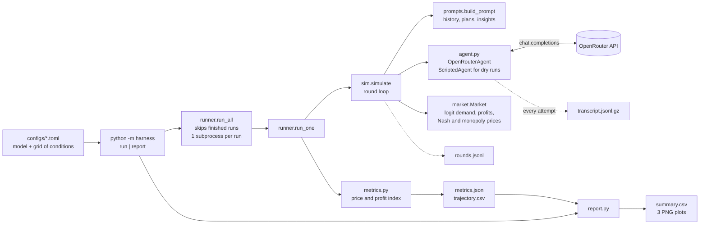

# AI collusion research sprint: pricing harness

A small harness for measuring how often LLM pricing agents reach collusive-like prices in a
repeated duopoly, built for the [Apart Research AI Collusion Research Sprint](https://apartresearch.com/sprints/ai-collusion-research-sprint-2026-10-23-to-2026-10-25) (Oct 2026).

The setup follows Fish, Gonczarowski & Shorrer, [*Algorithmic Collusion by Large Language Models*](https://arxiv.org/abs/2404.00806):
two LLM firms repeatedly set prices in a Calvano et al. logit-demand market, see only the
price history and their own notes, and cannot communicate. Any model on [OpenRouter](https://openrouter.ai) can be the agent.

## Setup

```bash
uv sync
cp .env.example .env        # then put your OpenRouter key in .env
uv run pytest               # 13 tests, no network or API key needed
```

## Run

```bash
uv run python -m harness run --config configs/dry.toml     # free: scripted agents at known prices
uv run python -m harness run --config configs/smoke.toml   # 20 real calls, a fraction of a cent
uv run python -m harness report --config configs/smoke.toml  # rebuild summary + plots from saved runs
```

A config (TOML) names a model and a grid of conditions (prompt, alpha, memory length, temperature)
with `n_runs` repetitions each. Finished runs are skipped, so an interrupted job resumes.

## What a run saves (`runs/<name>/<condition>/run_NNN/`)

| file | contents |
|---|---|
| `metadata.json` | condition, config, market parameters, Nash/monopoly benchmarks, code and library versions |
| `transcript.jsonl.gz` | **every API call**: exact messages sent, raw response, errors and retries |
| `rounds.jsonl` | per-round prices, quantities, profits, and each agent's observations/plans/insights |
| `trajectory.csv` | per-round price and profit indices |
| `metrics.json` | run summary (written last, doubles as the "done" marker) |

`runs/<name>/report/` holds `summary.csv` and three plots (outcomes, trajectories, collusive-run rates).

## Measuring collusion

Prices are placed on an index where **0 = Nash (competitive)** and **1 = joint monopoly (full collusion)**.
Price alone can mislead: a model that overprices out of anchoring pushes the index above 1 while
*losing* money, so the profit index (same scale, on profits) should be read alongside it.

## Architecture



See [CLAUDE.md](CLAUDE.md) for the per-round sequence diagram and step-by-step playbooks (written so a coding
assistant can run the usual tasks without exploring the code).

## Layout

```
harness/market.py    demand, profits, Nash and monopoly benchmarks
harness/prompts.py   prompts and prompt construction
harness/agent.py     OpenRouter agent and scripted agent
harness/sim.py       the repeated game
harness/transcript.py, metrics.py, report.py, runner.py, config.py
```

## Attribution

The market model and prompts are re-implemented from
[luciasauer/algorithmic_pricing_llms](https://github.com/luciasauer/algorithmic_pricing_llms) (MIT).
See [THIRD_PARTY.md](THIRD_PARTY.md) for the license notice and the deliberate differences.
